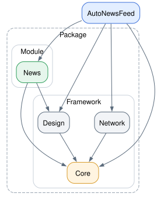
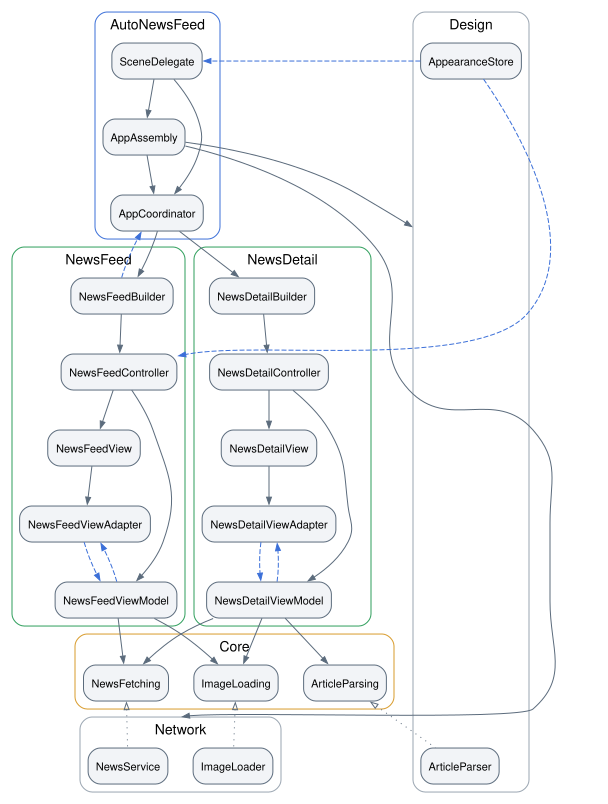

# AutoNewsFeed

- Приложение написано в Xcode 27
- Приложение проверено на таргетах iOS 18 (sim) и iOS 27 (sim)
- Минимальный деплой iOS 18
- Модули лежат внутри `Package`
- Само приложение содержит только entry point и сборку зависимостей
- Для запуска выбрать схему `AutoNewsFeed`
- В `Scripts` есть лежит bash-скрипт для смены темплейта swift файла:

  ```bash
  cd Scripts && bash copyIDETemplateMacros.sh
  ```

## Структура

```
AutoNewsFeed/
Package/
  Source/
    Framework/
      Core/
      Network/
      Design/
    Module/
      News/
        NewsFeed/
        NewsDetail/
Graph/
Scripts/
```

### Модули



| Модуль | Что внутри |
|---|---|
| **Core** | протоколы, модели, строки и DI |
| **Network** | сервисы api, ошибок и загрузки картинок |
| **Design** | токены, тема, общие вью |
| **News** | экраны `NewsFeed` и `NewsDetail` |

### Экраны и связи



Каждый экран собран из одинаковых частей. Их роли закреплены протоколами в Core:

| Часть | Роль |
|---|---|
| **Builder** | собирает модуль и отдаёт `UIViewController` |
| **Controller** | связывает `Adapter` и `ViewModel`, настраивает NavBar |
| **View** | CollectionView и Layout |
| **Adapter** | `DataSource` и `Delegate` для `CollectionView`, регистрирует `Action` |
| **ViewModel** | хранит `State`, обрабатывает `Action`, работает с сетью |
